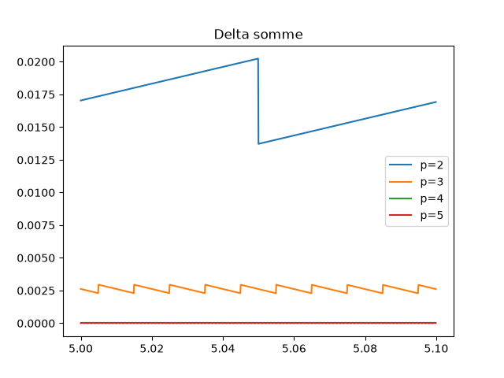
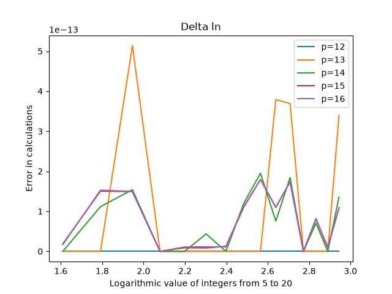

# CORDIC Numerical Methods

Python experiments on the limits of machine number representation and on CORDIC-style algorithms for computing `ln`, `exp`, `tan` and `arctan` with only additions, subtractions and precomputed constants.

School project (numerical methods course), ENSEIRB-MATMECA, January-February 2024. Team project of four students (see [Authors](#authors)).

## Features

- **Reduced decimal representation**: `rp(x, p)` rounds a number to `p` significant digits, simulating a low-precision machine.
- **Relative error analysis**: relative error of sums and products computed on reduced representations, plotted for several precisions.
- **Series approximation of ln(2)**: alternating harmonic series computed to a given precision, with the accumulated rounding error.
- **CORDIC algorithms** (calculator-style, base 10): `ln`, `exp`, `tan` and `arctan`, compared against Python's `math` module with error plots for precisions 12 to 16.
- **Report** (French, LaTeX): `report/report.pdf` presents the method and analyses the results.

| Relative error of a sum | CORDIC `ln` error |
| --- | --- |
|  |  |

## Tech stack

Python 3, matplotlib, LaTeX.

## Getting started

```bash
python3 -m venv .venv
.venv/bin/pip install -r requirements.txt

cd src
../.venv/bin/python Projet_1_exo1.py          # part 1: rp, relative errors of sum/product
../.venv/bin/python Projet_1_algos_CORDIC.py  # part 2: ln(2) series and CORDIC functions
```

Each script prints its test values and opens the plots one window at a time. `Projet_1_algos_CORDIC.py` imports `Projet_1_exo1.py`, so the part 1 plots are shown first.

To rebuild the report:

```bash
cd report
pdflatex report.tex && pdflatex report.tex
```

## Project structure

```
src/      Python sources (part 1 and part 2)
report/   LaTeX report, its figures and the compiled PDF
docs/     Plots regenerated from the current code, used in this README
```

## Authors

Arthur Dufetrelle, together with three fellow ENSEIRB-MATMECA students.
